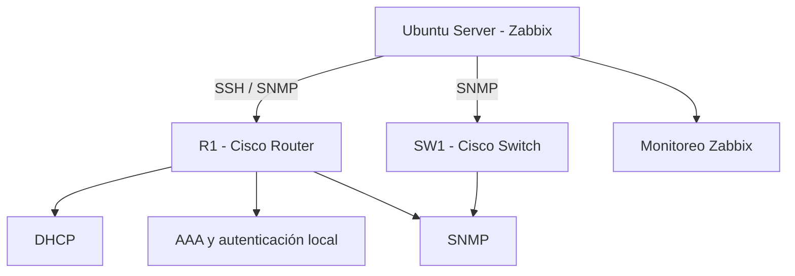

# Laboratorio de Seguridad de Infraestructura de Redes – ITLA

## 🎥 VIDEO DEMOSTRATIVO

**Video de presentación y demostración del laboratorio:**

[VER VIDEO DEMOSTRATIVO EN YOUTUBE](PEGAR_AQUI_EL_ENLACE_DEL_VIDEO)

---

## 1. Descripción del proyecto

Este repositorio contiene la documentación técnica, configuraciones, scripts, diagramas y evidencias correspondientes al laboratorio de Seguridad de Infraestructura de Redes.

El proyecto consiste en implementar, administrar, monitorear y evaluar la seguridad de una infraestructura de red utilizando dispositivos Cisco, un servidor Ubuntu y herramientas especializadas de monitoreo y auditoría.

Se implementan mecanismos de autenticación y autorización, administración remota segura, monitoreo mediante SNMP, asignación dinámica de direcciones IP mediante DHCP y evaluación de configuraciones de seguridad basadas en recomendaciones CIS.

## 2. Propósito del laboratorio

El propósito principal es aplicar conocimientos prácticos de administración y seguridad de infraestructura de redes, fortaleciendo los mecanismos de protección de los dispositivos y servicios que forman parte de una red empresarial.

Se busca:

- Implementar mecanismos de autenticación, autorización y registro de eventos mediante AAA.
- Configurar el acceso administrativo remoto utilizando SSH.
- Deshabilitar protocolos de administración inseguros como Telnet.
- Implementar asignación automática de direcciones IP mediante DHCP.
- Configurar SNMP para obtener información de los dispositivos de red.
- Implementar Zabbix para monitorear el router y el switch.
- Realizar evaluaciones de seguridad basadas en CIS Benchmark.
- Identificar configuraciones inseguras y documentar oportunidades de mejora.
- Aplicar medidas de hardening para fortalecer la infraestructura.

## 3. Arquitectura del laboratorio

### Topología de red

La infraestructura está compuesta por:

| Dispositivo | Dirección IP | Función |
|---|---|---|
| R1 – Cisco | 10.23.13.1/24 | Enrutamiento, DHCP, AAA y SNMP |
| SW1 – Cisco | 10.23.13.2/24 | Conmutación y administración SNMP |
| Ubuntu Server | DHCP (esperada: 10.23.13.4) | Zabbix y herramientas de auditoría |

**Segmento de red:** 10.23.13.0/24

### Diagrama lógico

## 4. Tecnologías y herramientas utilizadas

| Tecnología | Aplicación |
|---|---|
| GNS3 | Simulación de infraestructura de red |
| VMware | Virtualización de servidores |
| Cisco IOS | Administración de router y switch |
| Ubuntu Server | Servidor de monitoreo |
| Zabbix | Monitoreo de infraestructura |
| SNMP v2c | Obtención de información de dispositivos |
| DHCP | Asignación dinámica de direcciones IP |
| AAA | Autenticación y autorización |
| SSH | Administración remota segura |
| CIS Benchmark | Referencia para evaluación de seguridad |
| Python | Automatización y auditoría |

## 5. Desarrollo del laboratorio

### 5.1. Configuración de infraestructura Cisco

Se realiza la configuración inicial de los dispositivos Cisco R1 y SW1, incluyendo direccionamiento IP, parámetros de administración y conectividad entre los equipos.

Se documentan las configuraciones mediante archivos Running-Config.

Documentación: [Configuración Cisco](Running-Config)

### 5.2. Logs de AAA y RADIUS

Se implementan mecanismos de autenticación y autorización para controlar el acceso administrativo a los dispositivos.

Se realizan pruebas de acceso exitoso y fallido para verificar el comportamiento del sistema y la generación de registros.

Evidencia: [AAA y RADIUS]()

### 5.3. Acceso administrativo por SSH

Se configura el acceso administrativo remoto mediante SSH utilizando usuarios locales y contraseñas protegidas.

Se restringe el acceso remoto exclusivamente al protocolo SSH, deshabilitando Telnet en los dispositivos.

Evidencia: [Acceso SSH]

### 5.4. Zabbix, DHCP y SNMP

Se implementa Zabbix sobre Ubuntu Server para monitorear los dispositivos de red.

El servidor obtiene su dirección IP mediante DHCP y utiliza SNMP para consultar información del router y del switch.

Se incorporan los dispositivos a Zabbix para visualizar sus parámetros de operación y monitoreo.

Evidencia: [Zabbix, DHCP y SNMP](
)

## 11. Conclusión

Este laboratorio permite integrar diferentes mecanismos de seguridad y administración de infraestructura de redes, aplicando conocimientos de configuración de dispositivos Cisco, autenticación, monitoreo y evaluación de seguridad.

La documentación y las evidencias recopiladas permiten demostrar el funcionamiento de los servicios implementados y establecer una referencia para futuras actividades de hardening y mejora continua de la seguridad.

---

**Proyecto académico – ITLA**

**Área:** Seguridad de Infraestructura de Redes

**Identificador de direccionamiento:** 10.23.13.0/24
